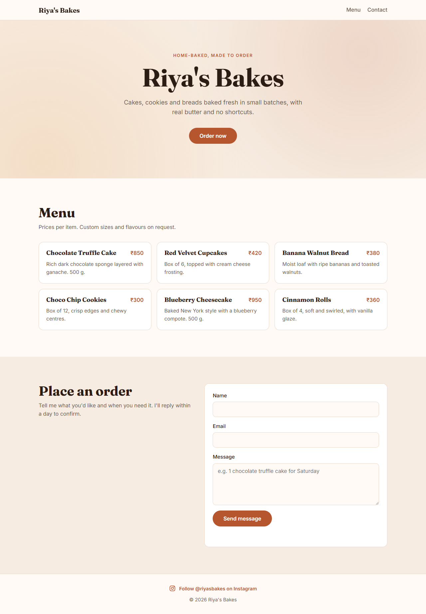
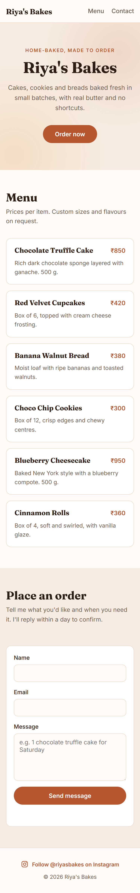

# Riya's Bakes

A responsive single-page landing site for Riya's Bakes, a home bakery. It has a hero with an "Order now" button, a six-item menu with prices in ₹, a contact form, and an Instagram link in the footer.

Plain HTML and CSS with no build step and no dependencies.

## Run locally
Open `index.html` in a browser, or serve the folder:

```bash
python -m http.server 5050
```

Then visit http://localhost:5050.

## Responsive breakpoints
The layout is desktop-first with two CSS media queries in `styles.css`. The page also sets `<meta name="viewport" content="width=device-width, initial-scale=1">`.

| Width | Layout |
| --- | --- |
| above 960px (desktop) | Wide hero, menu in a 3-column grid, contact text and form side by side |
| 641px to 960px (tablet) | Menu in a 2-column grid |
| 640px and below (mobile) | Single column throughout, full-width submit button, tighter section spacing |

Tested at 1280px and 375px with no horizontal scroll.

## Desktop preview


## Mobile preview


## Contact form
The form checks its fields in the browser and shows a confirmation message. It doesn't send messages anywhere yet. To receive orders by email, point it at a form service such as Formspree.

## Deployment
Deployed with GitHub Pages from the `main` branch root.

## License
MIT
